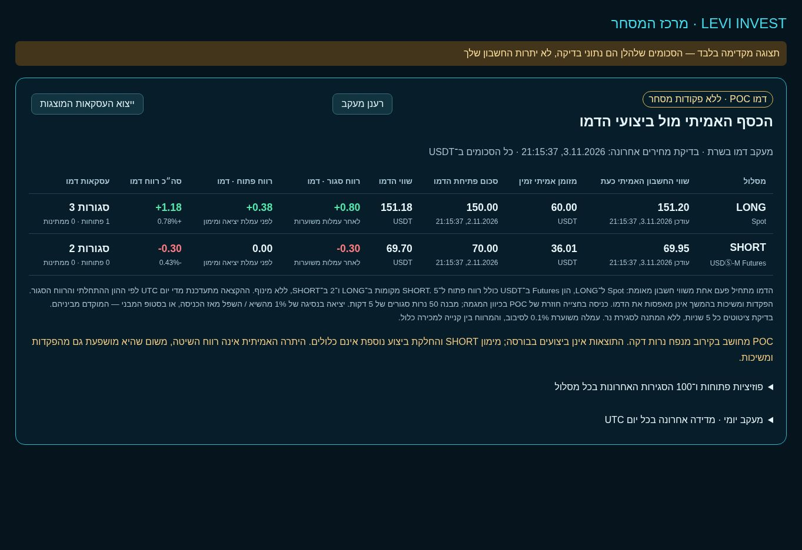

# מעקב POC דמו מול חשבון אמיתי

הטבלה נמצאת במסכי המסחר, התיק והרווח וההפסד בבייננס. היא אינה משנה הגדרות או פוזיציות LIVE, ואינה משתמשת במנגנון Binance Testnet. זהו יומן סימולציה עצמאי בשרת.

## הון וחישוב

- LONG: שווי Spot כולל החזקות, לאחר אימות שלכל יתרה יש מחיר. מוצג בנפרד מזומן USDT פנוי.
- SHORT: ארנק USDT Futures בתוספת רווח פתוח, בחשבון single-asset. מוצג בנפרד מזומן זמין.
- סכום הפתיחה נלקח אוטומטית פעם אחת מקריאת חשבון מלאה ועדכנית; יתרה חסרה אינה מוחלפת ב־150/70 או באפס. אין התחלה על הון אפס.
- חשבונות דמו נפרדים: 5 מקומות LONG ו־2 SHORT, ללא מינוף, הקצאת היום = (הון התחלתי + רווח סגור נטו) / מספר המקומות. עדכון בגבול יום UTC; סכום פוזיציה קיימת אינו משתנה. אין שימוש כפול במזומן.
- הפקדות ומשיכות LIVE אינן מאפסות או מתווספות לדמו. לכן הפרש יתרות אמיתיות אינו מוצג כרווח אסטרטגיה.
- רווח פתוח מחושב לפי bid למכירת LONG ו־ask לסגירת SHORT. עמלה משוערת 0.1% לסיבוב, מחציתה בכל ביצוע לפי השווי שלו. מרווח קנייה/מכירה נכלל. רווח פתוח מנוכה מעמלת הכניסה בלבד; אינו כולל מימון Futures, עמלת יציאה עתידית או החלקה נוספת.

## הגדרת השיטה

50 נרות סגורים ורציפים של 5 דקות. קיצון מאושר מול 2 נרות מכל צד. LONG: L1,H1,L2,H2 עם שפל ושיא עולים; SHORT הפוך. POC קבוע לגל האחרון: 24 מדרגות מחיר, נפח נרות דקה מחולק באופן אחיד על הטווח שלהם (קירוב, לא עסקאות tick). נתוני Spot ל־LONG ונתוני Futures ל־SHORT.

לאחר גילוי התבנית נדרשת תצפית חדשה בצד הנגדי וחצייה חזרה. אין כניסה רטרואקטיבית לפי נרות שקדמו לתחילת המעקב. קונים במחיר ask שנצפה או פותחים SHORT במחיר bid שנצפה; אין הנחה שמחיר POC היה בר ביצוע. תבנית פגה לאחר 120 דקות, או נפסלת בשבירת הקיצון המבני. תבנית מנוצלת אינה נפתחת שוב.

יציאה לאחר נסיגה **גדולה מ־1%** משיא LONG / משפל SHORT מאז הכניסה, או הגעה לסטופ המבני — הגבול הקרוב. אין יעד רווח, סף הפעלה או המתנה לסגירת נר. זהו פרמטר הניסוי המקורי, לא אימוץ של 8% מהאופטימיזציה ההיסטורית. נרות נסרקים בהדרגה פעם בכל חלון 5 דקות; ציטוטים נדגמים כל 5 שניות. תנועות ביניהם עשויות להתפספס; אין הבטחת ביצוע רציף.

## אמינות ותפעול

מצב נשמר בקובץ נפרד `BINANCE_POC_PAPER_FILE` או ליד יומן LIVE בסיומת `.poc-paper`, עם הרשאות 0600 ושמירה אטומית. הוא נשמר אחרי סגירת הדפדפן ואחרי restart. פתיחה מחדש של השרת מבטלת חצייה ממתינה ומסמנת פוזיציות פתוחות ככאלה שעברו פער מעקב. פער ציטוט מעל 15 שניות מסומן; אין שחזור בדיעבד של מחיר יציאה. מחיר ישן מעל 10 שניות מסתיר רווח פתוח ושווי כולל עד להתחדשותו. יומן פגום או כשל שמירה עוצרים דמו ואינם מאפסים תוצאות.

הטבלה מציגה 100 סגירות אחרונות לכל כיוון; הסכומים כוללים את כל הסגירות. CSV מייצא את העסקאות המוצגות. יומן מלא נשמר עד 50,000 עסקאות לכיוון, ואז כניסות דמו נוספות נחסמות בלי למחוק היסטוריה.

API: `GET /api/binance-poc-paper`, מוגן באימות מכשיר, ללא POST/reset/order. אותו נתיב מותר בפרוקסי הקריאה של Netlify. `pocPaper` ב־`/api/binance-mode` מציין יכולת בלבד, לא מוכיח יתרות או התחלת מעקב.

התקנה: `scripts/install-poc-paper.sh <commit SHA>`. המתקין בודק שחרור וגם שילוב עם קובצי השרת המקומיים; משנה רק ווים מוספים וקבצי הדמו, מגבה ומחזיר קבצים קודמים בכשל startup. הוא אינו משנה `.env`, הגנות, יומנים או הקצאות LIVE. נדרשת בדיקת API מאומת או הטבלה המחוברת לאימות שהמעקב אכן התחיל.

## מצב הבדיקה לפני פרסום

16 בדיקות הדמו, התצוגה והמתקין עברו. נבדקה תצוגת הטבלה בדפדפן במחשב וברוחב טלפון 390px, עם נתוני בדיקה מסומנים בלבד. אין בכך אימות של יתרות החשבון החי.

בבדיקה הכוללת עברו 1,159 מתוך 1,161 בדיקות. שני הכשלים במתקינים הקודמים (`binance-poc-installer.test.mjs`, `binance-trading-pnl.test.mjs`) שוחזרו גם בגרסת הבסיס `97202d919035344baab01410670850271753e2cb`, לפני התוספת הזאת.

